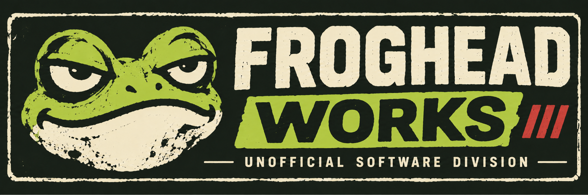
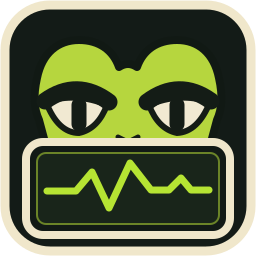
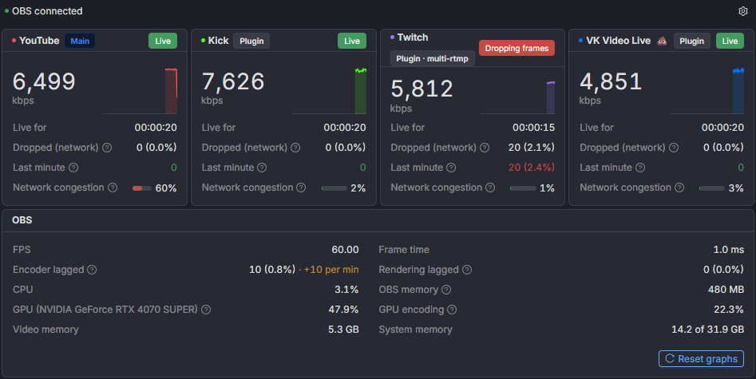

<p align="center">
  
</p>

<p align="center">
  
</p>

<h1 align="center">StreamoScope</h1>

<p align="center">
  <strong>Your stream, under observation.</strong><br>
  A live monitoring dock for <a href="https://obsproject.com/">OBS Studio</a>.<br>
  Built by <strong>Froghead Works</strong> — an independent software workshop.
</p>

<p align="center">
  <a href="https://github.com/tjnk24/streamoscope/releases">Download</a> ·
  <a href="#installation">Installation</a> ·
  <a href="#what-it-monitors">Features</a> ·
  <a href="#known-limitations">Limitations</a> ·
  <a href="https://github.com/tjnk24/streamoscope/issues">Report an issue</a>
</p>

---

OBS says you're live. Good. But what's your bitrate doing? Are frames disappearing? Is the encoder quietly having a breakdown?

**StreamoScope keeps an eye on your stream's vital statistics while you focus on the actual show.** It sits inside OBS, watches your main stream and supported additional outputs, and gives the important numbers a place of their own.

It won't fix your internet connection. We filed a complaint with the internet. No response yet.

<p align="center">
  
</p>
<p align="center"><sub>Example data shown. Your actual stream may be less cooperative.</sub></p>

## What it monitors

- **Live bitrate:** current readings and a two-minute history chart for detectable outputs.
- **Dropped frames:** totals, recent network drops, congestion, connection health and reconnecting status.
- **Streaming destinations:** the main OBS output and supported additional outputs, with platform detection where available.
- **OBS performance:** FPS, rendering time, encoding skips, rendering misses, CPU usage and OBS memory.
- **Extra hardware stats on Windows:** GPU usage, hardware encoder load, VRAM and system memory using the optional Lua bridge.
- **Useful extras:** built-in diagnostics, a mock/demo mode, signed update verification and update prompts inside the dock.
- **Five interface languages:** English, Russian, Spanish, German and Brazilian Portuguese.

Platform detection includes services such as YouTube, Twitch, Kick, VK Video Live, VK Video, Rutube, Telegram, Facebook and Trovo, where the output provides enough information to identify them.

> [!NOTE]
> StreamoScope is a **monitor**, not a streaming service, encoder or repair tool. It reports problems; solving them is regrettably still a human responsibility.

## Installation

### Windows installer — recommended

**You'll need:** OBS Studio **28+**, with its built-in obs-websocket 5 server. The installer is intended for **64-bit Windows 10/11**. Development and testing have been done with OBS 33 on Windows.

1. Download the latest `streamoscope-setup-<version>.exe` from [GitHub Releases](https://github.com/tjnk24/streamoscope/releases).
2. **Close OBS** and run the installer. Administrator privileges aren't required.
3. Start OBS and open **Docks → StreamoScope** if the dock isn't already visible.
4. Enter your OBS WebSocket connection details. Find them under **Tools → WebSocket Server Settings → Show Connect Info** (usually port `4455`).

That's it. Your stream is now under observation.

> [!IMPORTANT]
> **Coming from obs-stats-widget 0.x?** StreamoScope 0.3.0 is the same dock under its new name, and older versions can't update to it by themselves. Close OBS and run the new installer once: it removes obs-stats-widget first, and your saved password and settings come along.

The installer puts the dock and Lua bridge in `%LOCALAPPDATA%\Programs\streamoscope`, registers an uninstall entry, and configures the OBS dock and script. It saves backups in `%LOCALAPPDATA%\streamoscope\backups` and logs configuration steps to `%LOCALAPPDATA%\streamoscope\configure-obs.log`.

If OBS has never been started on this computer, launch it once, close it, then run the installer again. You may need to enable the WebSocket server in OBS yourself.

**Updates:** the dock can check for releases and offer an update. The updater verifies a minisign signature and won't start installation while OBS is streaming or recording. **Uninstall:** close OBS, then use Windows **Settings → Apps → StreamoScope**. The uninstaller leaves OBS WebSocket enabled in case other tools use it.

### Manual installation — ZIP / portable OBS

Prefer to do it yourself? We respect that kind of stubbornness.

1. Download `streamoscope-<version>.zip` from [Releases](https://github.com/tjnk24/streamoscope/releases) and extract it into a permanent folder.
2. In OBS, enable **Tools → WebSocket Server Settings → Enable WebSocket server**.
3. Open **Docks → Custom Browser Docks** and create a dock pointing to the extracted `dock/index.html` using a `file:///` URL:

   ```text
   file:///C:/path/to/streamoscope/dock/index.html
   ```

4. **Recommended:** open **Tools → Scripts**, add `streamoscope-bridge.lua` and keep its accompanying `streamoscope-bridge` folder next to the Lua file. Repeat in each scene collection you stream from.
5. Enter your OBS WebSocket port and password in the dock.

For a manual update, replace the extracted files with those from the new ZIP and press **Ctrl+R** in the dock.

## How it works

StreamoScope talks to OBS through its **built-in WebSocket server**. It doesn't require installing a custom OBS plugin.

The optional **Lua bridge** fills in details that WebSocket doesn't provide on its own: identifying supported additional output platforms, reporting extra Windows hardware stats, and opening or launching local update-related actions. Platform identification uses the server protocol and hostname, **not stream keys or URL paths**.

Without the bridge, the dock still works, but some output labels and hardware readings may be unavailable.

## Settings and privacy

Use the dock's **gear icon** to select a language, toggle the OBS statistics card, try mock mode, manage update checks or copy diagnostics for a bug report.

- **Local connection:** the dock normally connects to OBS at `127.0.0.1`.
- **Release checks:** when enabled, it checks `api.github.com` at startup and approximately once a day; otherwise you can check manually.
- **Credentials:** the OBS WebSocket password is kept in the dock's local browser storage. Stream keys aren't read.
- **Diagnostics:** generated reports exclude passwords, stream keys and server addresses.

There is no separate account or hosted StreamoScope service. The program runs inside your OBS setup.

## Known limitations

- **Multiple `obs-multi-rtmp` targets:** this plugin may report several targets under the same `multi-output` name. OBS WebSocket can then expose statistics for only one of them. StreamoScope warns about the ambiguity rather than inventing separate readings.
- **Unidentified plugin outputs:** some additional outputs may appear simply as **Plugin**.
- **Windows-only extra hardware metrics:** GPU, encoder, VRAM and system-memory readings require Windows and the Lua bridge.
- **Manual ZIP updates:** replace the files yourself; the bundled automatic updater depends on the installed bridge.

## Troubleshooting

| Problem | First thing to check |
| --- | --- |
| Can't find the dock | **Docks → StreamoScope** in OBS |
| Dock won't connect | Enable OBS WebSocket and confirm the port (usually `4455`) |
| WebSocket password rejected | **Tools → WebSocket Server Settings → Show Connect Info** |
| Platform names or GPU data are missing | Load `streamoscope-bridge.lua` in the active scene collection |
| Installer couldn't configure OBS | Check `%LOCALAPPDATA%\streamoscope\configure-obs.log` and rerun with OBS closed |
| Manually built dock looks stale | Rebuild with `npm run build:prod` and refresh the dock with **Ctrl+R** |

Still stuck? [Open an issue](https://github.com/tjnk24/streamoscope/issues), explain what happened and include **Settings → Diagnostics → Copy diagnostics** if possible. Please don't include passwords or stream keys.

## Build from source

You'll need **Node.js 24+**. Node 25 isn't supported by the current development server.

```bash
git clone https://github.com/tjnk24/streamoscope.git
cd streamoscope
npm install
npm run build:prod
```

Use the generated `build/index.html` and `obs-script/streamoscope-bridge.lua` for a manual installation. For a development server, run `npm run start:dev` (default port `3062`); `npm test` runs lint and unit checks.

Maintainers and curious people can find release building, installer testing, signed updates and other less glamorous details in [Development and release notes](docs/DEVELOPMENT.md).

## Download verification

Release downloads include minisign signatures and SHA-256 checksums. The Windows installer is **not Authenticode code-signed**, so Windows SmartScreen may display a warning. Verify the download before deciding whether to run it.

Using the [repository public key](minisign.pub):

```bash
minisign -Vm streamoscope-setup-<version>.exe -p minisign.pub
```

Or compare your download's SHA-256 hash against `SHA256SUMS.txt` from the same release:

```powershell
Get-FileHash .\streamoscope-setup-<version>.exe -Algorithm SHA256
```

Replace `<version>` with the actual release version in the filename.

## License and credits

[MIT License](LICENSE). StreamoScope is an independent project, not an official OBS Studio product.

Uses [minisign](https://github.com/jedisct1/minisign) (ISC) in the installer and [Inter](https://github.com/rsms/inter) (SIL Open Font License 1.1) as a bundled local font.

---

<sub><strong>Froghead Works</strong> · Independent Software Workshop · Small tools. Mildly bad attitude.</sub>
